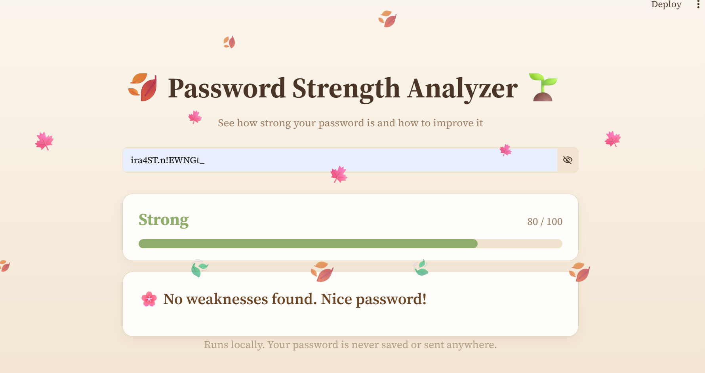
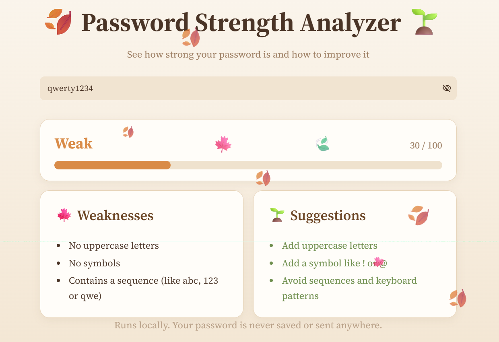

# 🍂 Password Strength Analyzer 🌱

Checks how strong a password is, finds common weaknesses and suggests how to fix them.
Works in the terminal or in a browser (Streamlit, with slowly falling autumn leaves).

## Screenshots

**Strong password**



**Weak password, with weaknesses and suggestions**



## How it works

Each password gets a score from 0 to 100:

| Check | Points |
|-------|--------|
| Length: 8+ chars / 12+ chars | +20 / +30 |
| Lowercase, uppercase, digit | +10 each |
| Symbol (`!@#$…`) | +15 |
| 3+ character types used | +5 bonus |

Penalties for common weaknesses:

| Weakness | Penalty |
|----------|---------|
| In the common-passwords list (1500 entries, case-insensitive) | −40 |
| Leetspeak of a common word (`dr@g0n`) | −30 |
| Repeated characters (`aaa`) | −10 |
| Sequences (`abc`, `123`, `qwe`) | −10 |
| Only one character type | −10 |
| Contains a year (`19xx`, `20xx`) | −5 |

| Score | Label |
|-------|-------|
| 0–29 | Very Weak |
| 30–49 | Weak |
| 50–69 | Medium |
| 70–84 | Strong |
| 85–100 | Very Strong |

More detail is in [docs/design_plan.md](docs/design_plan.md).

## Project structure

```
passwordStrengthAnalysis/
├── app.py                     # Streamlit web frontend
├── main.py                    # terminal version
├── scripts/analyzer.py        # analyze() and get_label()
├── database/common_passwords.txt
├── tests/test_analyzer.py
├── .streamlit/config.toml     # light brown theme
├── docs/                      # design plan and screenshots
└── requirements.txt
```

## Setup

```bash
uv venv .venv                  # or: python3 -m venv .venv
uv pip install -r requirements.txt   # or: .venv/bin/pip install -r requirements.txt
```

The analyzer and terminal version need only Python 3. Streamlit is needed just for the web app.

## Run

Web app:

```bash
.venv/bin/streamlit run app.py
```

Terminal:

```bash
python3 main.py
```

## Test

```bash
python3 -m unittest tests.test_analyzer -v
```

## Privacy

Everything runs locally. Passwords are never saved, logged or sent anywhere.
